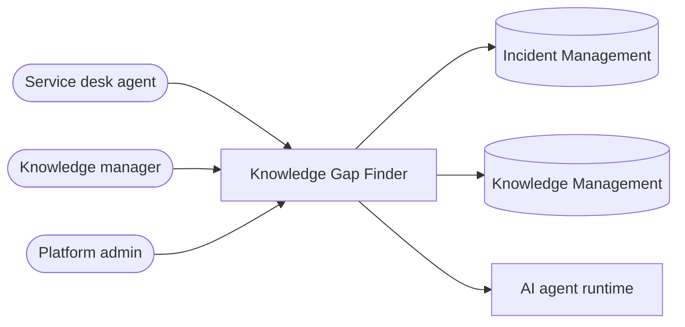
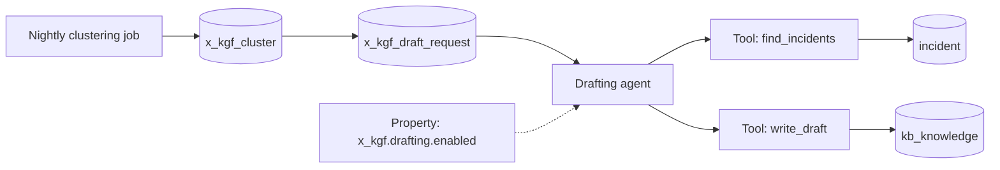
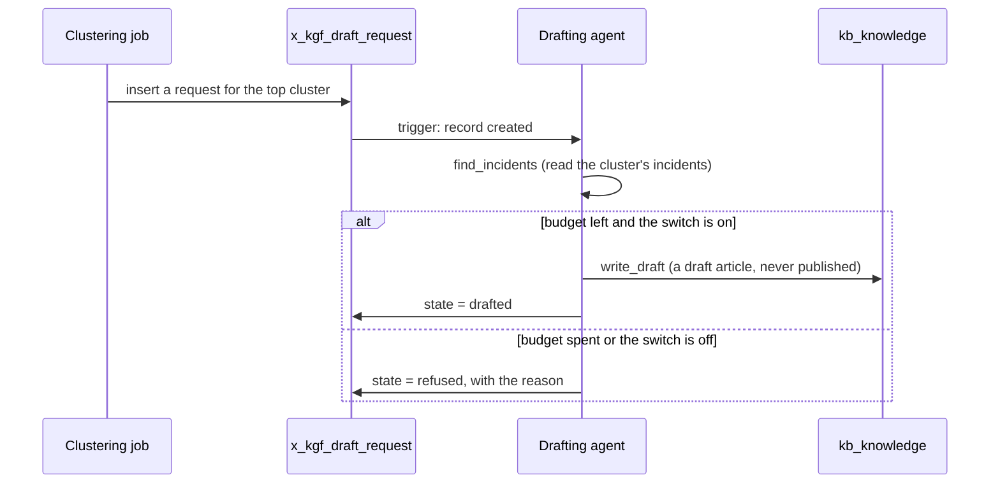
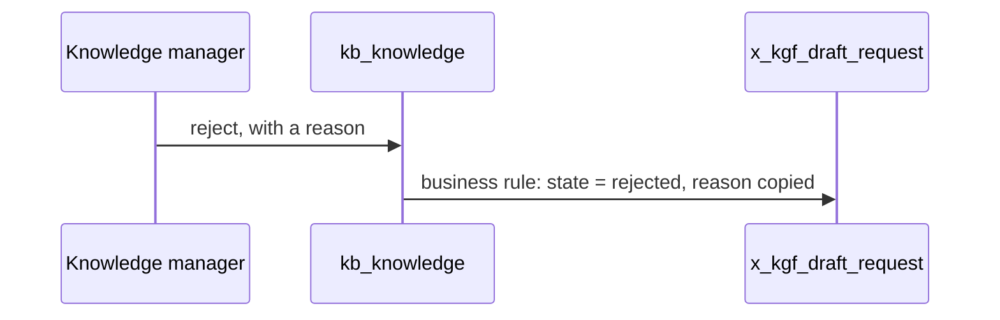
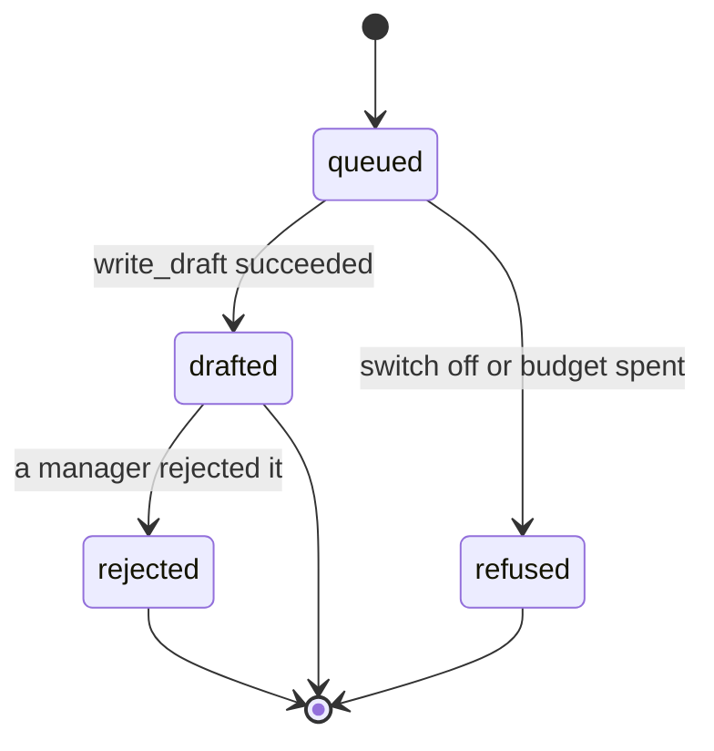

# As built: Knowledge Gap Finder

- Mode: full
- Read at: commit `4c1d9aa`, 2026-11-20
- Instance: alias `dev-test`, release Australia

## Summary

Knowledge Gap Finder finds groups of resolved incidents that have no
knowledge article, and has an AI agent draft one article per group. A
knowledge manager approves, edits or rejects each draft. Nothing is published
without a person. Drafting ships switched off and has a monthly budget.

## Context



| Piece | Kind | Where it comes from | On the instance |
|---|---|---|---|
| Service desk agent | Person | Role `x_kgf.user`, `src/roles.now.ts` | Found: `sys_user_role` |
| Knowledge manager | Person | Role `x_kgf.manager`, `src/roles.now.ts` | Found: `sys_user_role` |
| Platform admin | Person | Role `x_kgf.admin`, `src/roles.now.ts` | Found: `sys_user_role` |
| Incident Management | Platform service | Read by `find_incidents` | Not checked: platform table |
| Knowledge Management | Platform service | Written by `write_draft` | Not checked: platform table |
| AI agent runtime | Platform service | `src/agents/drafter.now.ts` | Found: `sn_aia_agent`, active |

## The pieces



| Piece | Kind | Where it comes from | On the instance |
|---|---|---|---|
| Nightly clustering job | Scheduled job | `src/jobs/cluster.now.ts` | Found: `sysauto_script`, active |
| x_kgf_cluster | Table | `src/tables/cluster.now.ts` | Found: `sys_db_object` |
| x_kgf_draft_request | Table | `src/tables/draft-request.now.ts` | Found: `sys_db_object` |
| Drafting agent | AI agent | `src/agents/drafter.now.ts` | Found: `sn_aia_agent`, active |
| find_incidents | Agent tool | `src/agents/tools/find-incidents.now.ts` | Found: `sn_aia_tool` |
| write_draft | Agent tool | `src/agents/tools/write-draft.now.ts` | Found: `sn_aia_tool` |
| incident | Platform table | Read by `find_incidents`, line 14 | Not checked: platform table |
| kb_knowledge | Platform table | Written by `write_draft`, line 31 | Not checked: platform table |
| x_kgf.drafting.enabled | System property | `src/properties.now.ts` | Found: `sys_properties`, value `false` |

## The agent

### Workflow and trigger

- **Agent:** Drafting agent, `src/agents/drafter.now.ts`. No agentic workflow:
  the agent is started directly.
- **Trigger:** a record created in `x_kgf_draft_request` with state `queued`.
- **Runs as:** the user `kgf.drafter`, which holds only `x_kgf.user`.

### Role and instructions

Quoted from `src/agents/drafter.now.ts`, lines 8 to 19:

```text
You draft one knowledge article for the cluster named in the request.
Read the cluster's incidents with find_incidents. Write the draft with
write_draft. Never publish. If write_draft refuses, stop and say why.
```

### Tools

| Tool | Type | Inputs | Outputs | Reads | Writes | Refuses when |
|---|---|---|---|---|---|---|
| find_incidents | Script | `cluster` (sys_id) | Up to 20 incidents: number, short description, close notes | `incident`, `x_kgf_cluster` | Nothing | The cluster isn't in state `ranked` |
| write_draft | Script | `cluster`, `title`, `body` | The draft's number | `sys_properties`, `x_kgf_budget` | `kb_knowledge` (workflow state draft), `x_kgf_draft_request` | The switch is off, the budget is spent, or the body is empty |

### Guardrails

| The agent can't | Enforced by | Where |
|---|---|---|
| Publish an article | `write_draft` sets only the draft state; `kgf.drafter` has no publish role | `src/agents/tools/write-draft.now.ts`, line 31 |
| Draft when switched off | `write_draft` reads `x_kgf.drafting.enabled` first | `src/agents/tools/write-draft.now.ts`, line 12 |
| Spend past the budget | `write_draft` compares the month's count with `x_kgf.drafting.monthly_budget` | `src/agents/tools/write-draft.now.ts`, line 18 |

### What reaches the model

- From each incident: number, short description and close notes. No caller,
  no email, no work notes.
- The cluster's label and size.
- Nothing from `kb_knowledge`.

## Data flows

### One record's path



| Step | What happens | Where it comes from | On the instance |
|---|---|---|---|
| 1 | The job inserts a request | `src/jobs/cluster.now.ts`, line 40 | Found: 3 rows in `x_kgf_draft_request` |
| 2 | The trigger starts the agent | `src/agents/drafter.now.ts`, `triggerConfig` | Found: `sn_aia_trigger_configuration`, active |
| 3 | The agent reads the incidents | `src/agents/tools/find-incidents.now.ts` | Not checked: no run read |
| 4 | The draft is written, or refused | `src/agents/tools/write-draft.now.ts`, lines 12 to 29 | Not checked: no run read |

### Other paths

#### A manager rejects a draft



| Step | What happens | Where it comes from | On the instance |
|---|---|---|---|
| 1 | The manager rejects the draft | Platform: the Knowledge approval | Not checked: platform behaviour |
| 2 | The request records the reason | `src/rules/copy-rejection.now.ts` | Found: `sys_script`, active |

### Who writes and reads each table

| Table | Written by | When | Read by |
|---|---|---|---|
| x_kgf_cluster | Clustering job | Nightly | `find_incidents`, the dashboard |
| x_kgf_draft_request | Clustering job; `write_draft`; the rejection rule | On ranking; at the end of a run; on a rejection | The trigger, the dashboard |
| x_kgf_budget | `write_draft` | After each draft | `write_draft` |
| kb_knowledge | `write_draft` (draft state only) | During a run | Knowledge managers |

### A run's life



| State | Set by | Where it comes from | On the instance |
|---|---|---|---|
| queued | Clustering job | `src/jobs/cluster.now.ts`, line 40 | Found: choice on `x_kgf_draft_request.state` |
| drafted | `write_draft` | `src/agents/tools/write-draft.now.ts`, line 36 | Found: choice |
| refused | `write_draft` | `src/agents/tools/write-draft.now.ts`, line 14 | Found: choice |
| rejected | The rejection rule | `src/rules/copy-rejection.now.ts` | Found: choice |

### Across the scope boundary

| Outside table | Access | Declared in | Why |
|---|---|---|---|
| incident | Read | `src/privileges.now.ts`, line 3 | `find_incidents` reads resolved incidents |
| kb_knowledge | Create, read | `src/privileges.now.ts`, line 9 | `write_draft` writes drafts |

## Configuration

| Name | Kind | Value as installed | What it controls |
|---|---|---|---|
| x_kgf.drafting.enabled | Property | `false` | The off switch: no drafts while false |
| x_kgf.drafting.monthly_budget | Property | `50` | Drafts allowed in a calendar month |
| x_kgf.user | Role | | Reads clusters and requests |
| x_kgf.manager | Role | | Approves and rejects drafts |
| x_kgf.admin | Role | | Changes the two properties |
| Nightly clustering job | Scheduled job | Daily, 02:00 | Finds and ranks clusters |

Seed data: 40 generated demo incidents, `src/seed/incidents.now.ts`. No real records.

## As built against as designed

| Design term | Designed | Built |
|---|---|---|
| C4 | A rate limit of 10 drafts an hour | No rate limit found in `src/`: only the monthly budget |

## Not verified

- Whether a real run reaches `write_draft`: no run was read, only the wiring.
- The rejection rule's behaviour: found and active, never seen firing.

## Where next

- To install, run and fix the app: [RUNBOOK.md](../RUNBOOK.md).
- The handoff's verdict and open items: [HANDOFF.md](../HANDOFF.md).
- Why it is built this way: the design records in this folder.
