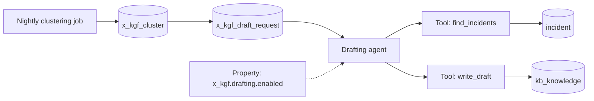
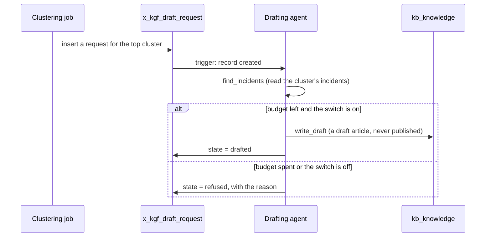

# As built: Knowledge Gap Finder

- Mode: light
- Read at: commit `4c1d9aa`, 2026-11-20
- Instance: alias `dev-test`, release Australia

## The pieces

| Piece | Kind | Where it comes from | On the instance |
|---|---|---|---|
| Nightly clustering job | Scheduled job | `src/jobs/cluster.now.ts` | Found: `sysauto_script`, active |
| x_kgf_cluster | Table | `src/tables/cluster.now.ts` | Found: `sys_db_object` |
| x_kgf_draft_request | Table | `src/tables/draft-request.now.ts` | Found: `sys_db_object` |
| Drafting agent | AI agent | `src/agents/drafter.now.ts` | Found: `sn_aia_agent`, active |
| find_incidents | Agent tool | `src/agents/tools/find-incidents.now.ts` | Found: `sn_aia_tool` |
| write_draft | Agent tool | `src/agents/tools/write-draft.now.ts` | Found: `sn_aia_tool` |
| incident | Platform table | Read by `find_incidents`, line 14 | Not checked: platform table |
| kb_knowledge | Platform table | Written by `write_draft`, line 31 | Not checked: platform table |
| x_kgf.drafting.enabled | System property | `src/properties.now.ts` | Found: `sys_properties`, value `false` |

## One record's path

| Step | What happens | Where it comes from | On the instance |
|---|---|---|---|
| 1 | The job inserts a request | `src/jobs/cluster.now.ts`, line 40 | Found: 3 rows in `x_kgf_draft_request` |
| 2 | The trigger starts the agent | `src/agents/drafter.now.ts`, `triggerConfig` | Found: `sn_aia_trigger_configuration`, active |
| 3 | The agent reads the incidents | `src/agents/tools/find-incidents.now.ts` | Not checked: no run read |
| 4 | The draft is written, or refused | `src/agents/tools/write-draft.now.ts`, lines 12 to 29 | Not checked: no run read |

## As built against as designed

| Design term | Designed | Built |
|---|---|---|
| C4 | A rate limit of 10 drafts an hour | No rate limit found in `src/`: only the monthly budget |

## Not verified

- Whether a real run reaches `write_draft`: no run was read, only the wiring.
